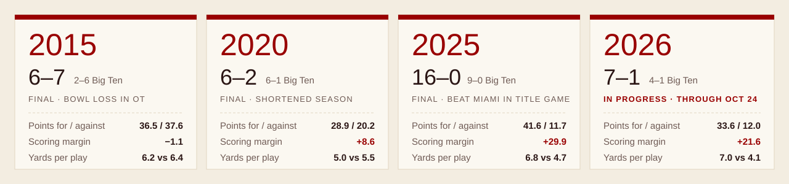

<p align="center">
  <a href="https://livsloffer.github.io/hoosiers/"></a>
</p>

<p align="center">
  <a href="https://livsloffer.github.io/hoosiers/"></a>
  
  
</p>



Indiana football season stats for four seasons. The repo holds the original stat reports, a CSV for every table in them, and a page that compares the seasons side by side.

## 🏈 The comparison page

**[livsloffer.github.io/hoosiers](https://livsloffer.github.io/hoosiers/)** has:

- Each season's record, scoring margin and turnover margin
- Indiana vs. opponents on 11 per-game stats, including points, yards, third downs, red-zone TDs and sacks
- Every game's margin of victory or defeat on one scale
- Points per game by quarter
- Passing, rushing, receiving, tackles, sacks, interceptions and scoring leaders

## Season leaders

| | 2015 | 2020 | 2025 | 2026* |
|---|---|---|---|---|
| **Passing** | Nate Sudfeld<br><sub>3,573 yds · 27 TD</sub> | Michael Penix Jr.<br><sub>1,645 yds · 14 TD</sub> | Fernando Mendoza<br><sub>3,535 yds · 41 TD</sub> | Josh Hoover<br><sub>1,741 yds · 18 TD</sub> |
| **Rushing** | Jordan Howard<br><sub>1,213 yds · 9 TD</sub> | Stevie Scott III<br><sub>561 yds · 10 TD</sub> | Roman Hemby<br><sub>1,120 yds · 7 TD</sub> | Turbo Richard<br><sub>711 yds · 6 TD</sub> |
| **Receiving** | Simmie Cobbs Jr.<br><sub>1,035 yds · 4 TD</sub> | Ty Fryfogle<br><sub>721 yds · 7 TD</sub> | Omar Cooper Jr.<br><sub>937 yds · 13 TD</sub> | Charlie Becker<br><sub>726 yds · 8 TD</sub> |
| **Tackles** | Marcus Oliver<br><sub>112</sub> | Micah McFadden<br><sub>58</sub> | Rolijah Hardy<br><sub>102</sub> | Isaiah Jones<br><sub>59</sub> |

<sub>*2026 through Oct 24, 2026.</sub>

## What's in the repo

| Path | Contents |
|---|---|
| `2015.pdf` … `2026.pdf` | The original season stat reports |
| `csv/<year>/` | One CSV per table: game results, team statistics, rushing, passing, receiving, defense, kicking, game-by-game and more |
| `docs/index.html` | The comparison page served by GitHub Pages |
| `hoosiers.html` | The same page in the format used for its Claude artifact |
| `scripts/` | The PDF-to-CSV converter, which uses only the Python standard library |

## Regenerating the CSVs

```sh
python3 scripts/convert.py . csv
```

This reads every `*.pdf` in the folder and writes `csv/<pdf name>/*.csv`. Values are kept as printed in the reports, including `—` or `.` for empty cells.

---

<sub>This is a fan project and is not affiliated with Indiana University.</sub>
